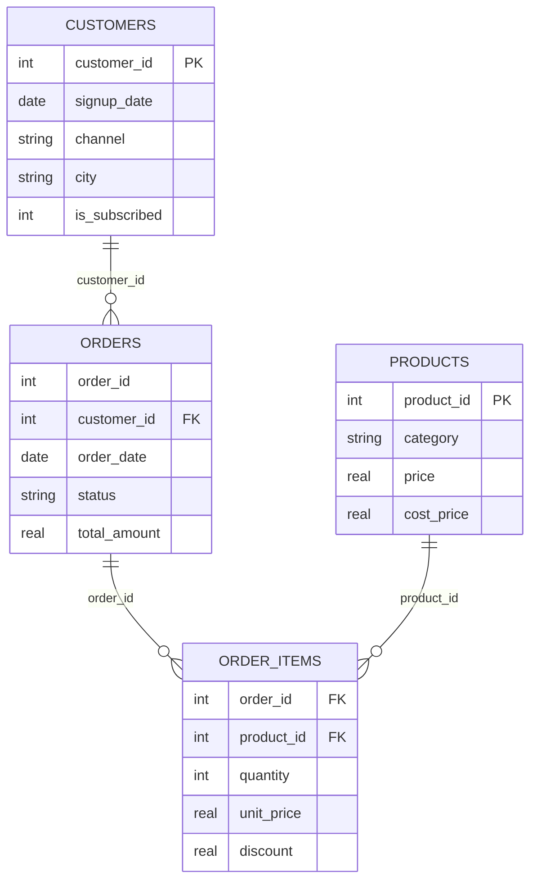
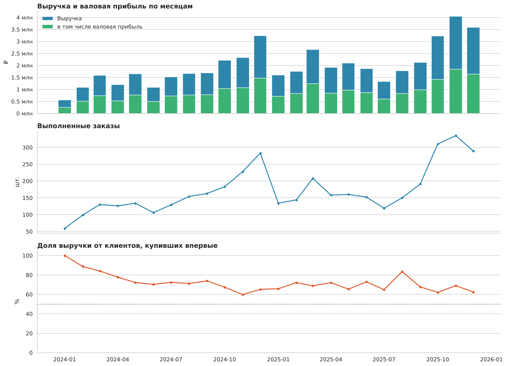
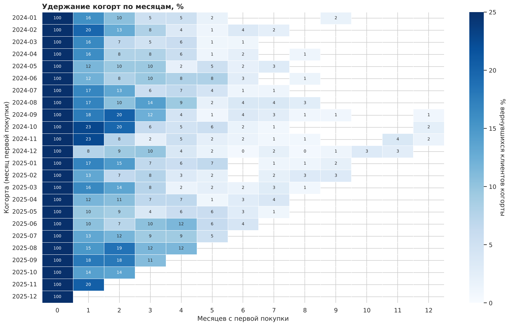
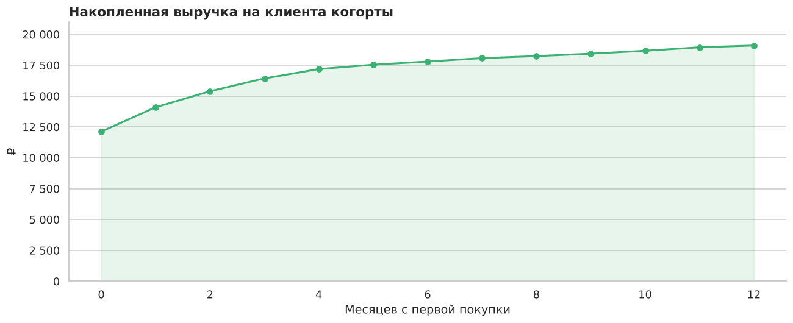
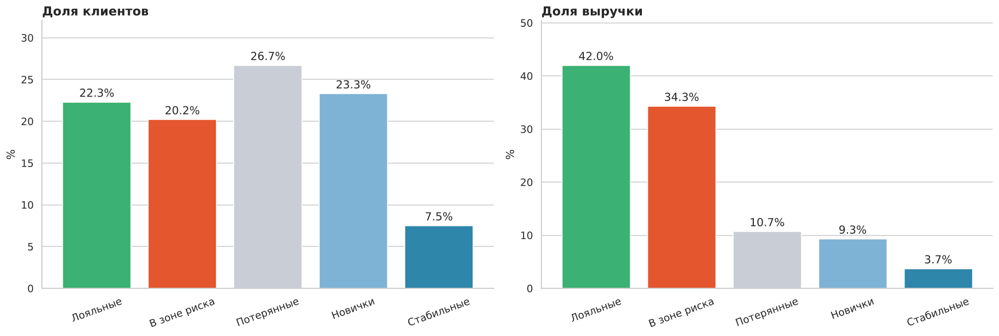
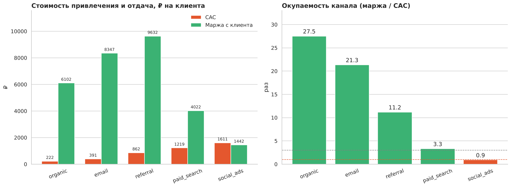
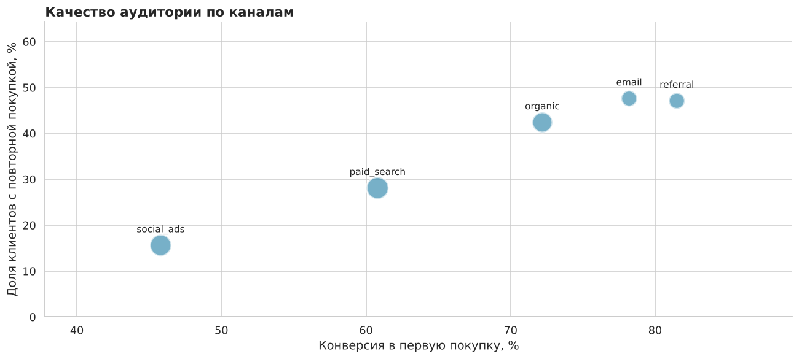
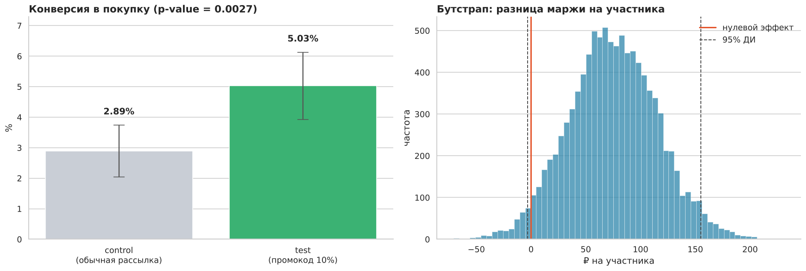

# Клиентская аналитика интернет-магазина

Пет-проект по анализу данных: полный цикл работы аналитика — от сырой выгрузки до выводов
и рекомендаций для бизнеса.

**Стек:** PostgreSQL, SQL (CTE, оконные функции), Python, pandas, NumPy, SciPy, SQLAlchemy, seaborn, matplotlib, Jupyter, Docker

## О проекте

Интернет-магазин товаров для дома работает два года и привлекает клиентов из пяти каналов.
Выручка растёт, но руководство не понимает, за счёт чего: приходят новые клиенты или
возвращаются старые, какие каналы окупаются, кого из клиентов ещё можно удержать.

Анализ отвечает на пять вопросов:

1. Можно ли доверять выгрузке и что в ней нужно починить?
2. За счёт чего растёт выручка — новых клиентов или повторных покупок?
3. Как быстро магазин теряет клиентов и различаются ли когорты между собой?
4. На какие группы делятся клиенты и где сосредоточены деньги?
5. Какие каналы привлечения окупаются, а какие работают в убыток?
6. Помогает ли промокод вернуть спящих клиентов — и окупается ли он?

Данные синтетические: их генерирует скрипт в репозитории, поэтому проект воспроизводится
целиком и не зависит от внешних источников. База разворачивается в Docker одной командой.

## Данные

Витрина собрана в PostgreSQL из шести таблиц:

| Таблица | Строк | Содержание |
|---|---|---|
| `customers` | 4 200 | клиент: дата регистрации, канал, город, устройство, подписка |
| `products` | 320 | товар: категория, цена, себестоимость |
| `orders` | 4 598 | заказ: клиент, дата, статус, оплата, сумма |
| `order_items` | 8 165 | позиция заказа: товар, количество, цена, скидка |
| `marketing_spend` | 120 | расходы на канал по месяцам |
| `ab_experiment` | 2 998 | распределение клиентов по группам A/B-теста |



В выгрузке намеренно оставлены дефекты, типичные для реальных данных: дубли строк, статусы
в разном регистре, выбросы в количестве, пропуски в необязательных полях. Их поиск и исправление —
первый шаг анализа.

## Основные результаты

**Качество данных.** В выгрузке нашлись дубли заказов, статусы в разном регистре и выбросы
в количестве товара. Без очистки выручка и число заказов оказались бы завышены. Очистка вынесена
в SQL-представления, поэтому все расчёты опираются на один согласованный слой данных.

**Рост держится на новых клиентах.** Выручка за два года — 47,8 млн ₽, валовая маржа стабильна
около 46%, но доля выручки от клиентов, купивших впервые, остаётся на уровне 69%. Это дорогая модель роста:
как только расходы на привлечение перестанут расти, остановится и выручка.



**Удержание падает очень быстро.** Повторную покупку делает лишь треть покупателей. Через месяц
после первой покупки возвращается около 15% когорты, через полгода — около 2%. Поздние когорты
ведут себя так же, как ранние: проблема не в конкретной кампании, а в работе с базой.



Накопленная выручка на клиента подтверждает это: основные деньги приходят в первый месяц,
дальше кривая почти плоская.



**Деньги сосредоточены в трети базы.** RFM-сегментация показала: «Лояльные» и «В зоне риска» —
это 43% клиентов, но 76% выручки. Сегмент «В зоне риска» (крупные покупки в прошлом, давно
не возвращались) — самая понятная точка роста, их не нужно привлекать заново.



**Один канал работает в минус.** Органика, рассылка и рекомендации окупаются многократно,
платный поиск — втрое. Платные соцсети приносят маржи меньше, чем стоит привлечение:
за период канал ушёл в минус на 174 тыс. ₽.



Причина видна в качестве аудитории: у соцсетей самая низкая конверсия в первую покупку (46%)
и самая низкая доля повторных покупок (16%). Канал приводит много людей, но не целевых.



**A/B-тест реактивации: механика работает, но маржа под вопросом.** Проверили на эксперименте,
возвращает ли спящих клиентов письмо с промокодом на 10%. Участники — 2 998 клиентов, не покупавших
90+ дней, случайно разделённые пополам.

| Метрика | control | test | Прирост | p-value | Значимо |
|---|---|---|---|---|---|
| Конверсия в покупку | 2,89% | 5,03% | +2,14 п.п. (+74%) | 0,003 | да |
| Выручка на участника | 283 ₽ | 497 ₽ | +76% | 0,02 | да |
| Маржа на участника | 125 ₽ | 199 ₽ | +60% | 0,06 | нет |



Перед разбором результата проверены корректность сплита (SRM, p = 0,66), отсутствие пересечений
между группами и сопоставимость групп по каналам привлечения. Конверсия сравнивается z-критерием
для долей, а выручка и маржа — бутстрапом: эти метрики сильно скошены (у большинства участников ноль),
и t-критерий для них не подходит.

Ключевой вывод — в последней строке таблицы: конверсия и выручка выросли значимо, но прирост маржи
статистически не доказан, промокод съедает часть выгоды. Решать по одной конверсии здесь нельзя.

**Рекомендации:** пересобрать бюджет платных соцсетей в пользу рассылки и реферальной программы,
раскатывать реактивацию, подобрав более дешёвый стимул вместо скидки, выстроить сценарии второй
покупки и следить за долей выручки от новых клиентов как за регулярной метрикой.

## Структура репозитория

```
.
├── notebooks/
│   └── customer_analytics.ipynb   # основной анализ с выводами
├── sql/
│   ├── 01_schema.sql              # схема базы
│   ├── 02_data_quality.sql        # чек-лист качества данных
│   ├── 03_clean_views.sql         # очищенные представления и витрина sales
│   ├── 04_key_metrics.sql         # метрики по месяцам
│   ├── 05_cohort_retention.sql    # когортное удержание
│   ├── 06_rfm_segments.sql        # RFM-сегментация (NTILE)
│   ├── 07_channel_economics.sql   # CAC, LTV, окупаемость каналов
│   └── 08_ab_test.sql             # выгрузка результатов A/B-теста
├── scripts/
│   ├── generate_data.py           # генерация датасета
│   ├── db.py                      # подключение к PostgreSQL
│   └── build_database.py          # создание схемы и загрузка CSV через COPY
├── data/raw/                      # сгенерированные CSV
├── images/                        # графики для README
├── docker-compose.yml             # локальный PostgreSQL
├── .env.example                   # шаблон параметров подключения
├── requirements.txt
└── README.md
```

## Как запустить

### 1. Зависимости

```bash
git clone https://github.com/ваш-логин/customer-analytics.git
cd customer-analytics
python -m venv venv
source venv/bin/activate        # Windows: venv\Scripts\activate
pip install -r requirements.txt
```

### 2. База данных

Проще всего поднять PostgreSQL в Docker:

```bash
docker compose up -d
```

Если PostgreSQL уже установлен локально, создайте базу вручную и пропишите свои параметры:

```bash
createdb shop
cp .env.example .env            # отредактируйте, если логин или порт отличаются
```

Параметры подключения читаются из `.env` (хост, порт, база, пользователь, пароль).
Файл `.env` в репозиторий не попадает, в нём нет ничего, кроме локальных настроек.

### 3. Данные и анализ

```bash
python scripts/generate_data.py    # создаёт CSV в data/raw/
python scripts/build_database.py   # создаёт схему и загружает данные через COPY
jupyter notebook notebooks/customer_analytics.ipynb
```

Ноутбук содержит сохранённые результаты, поэтому его можно просмотреть прямо на GitHub без запуска.
